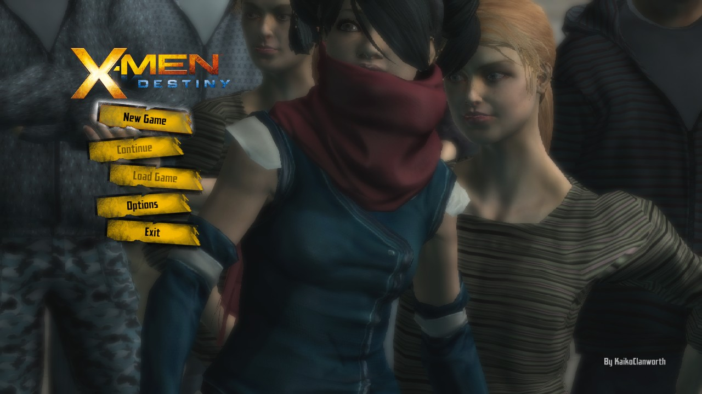
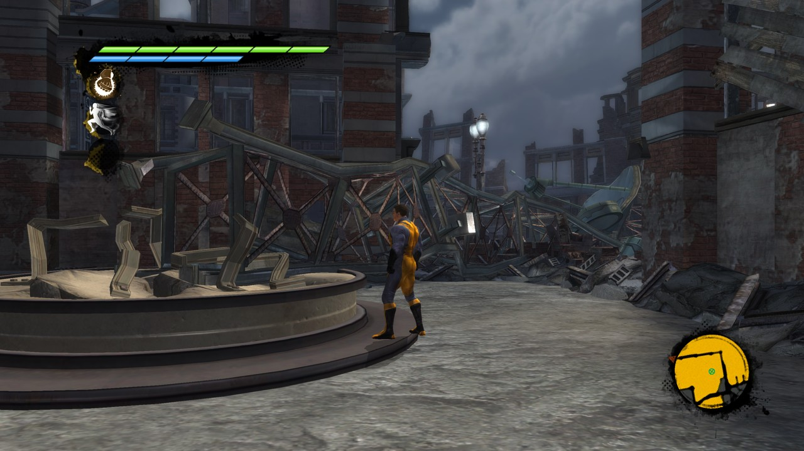
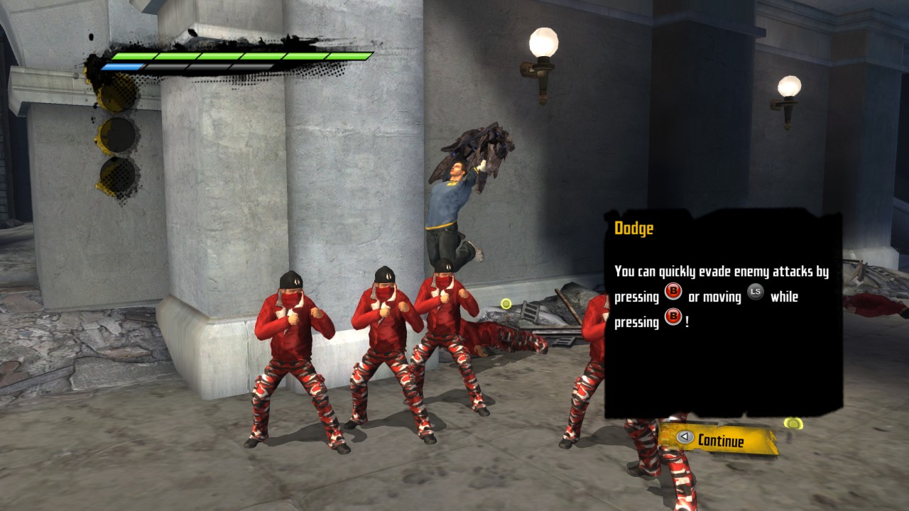
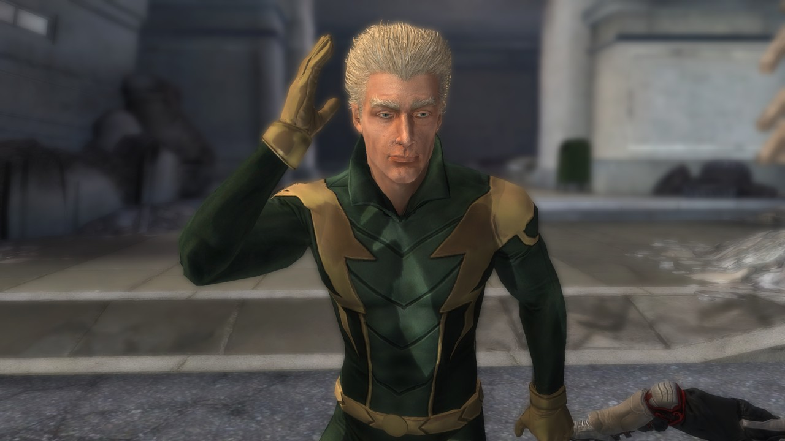
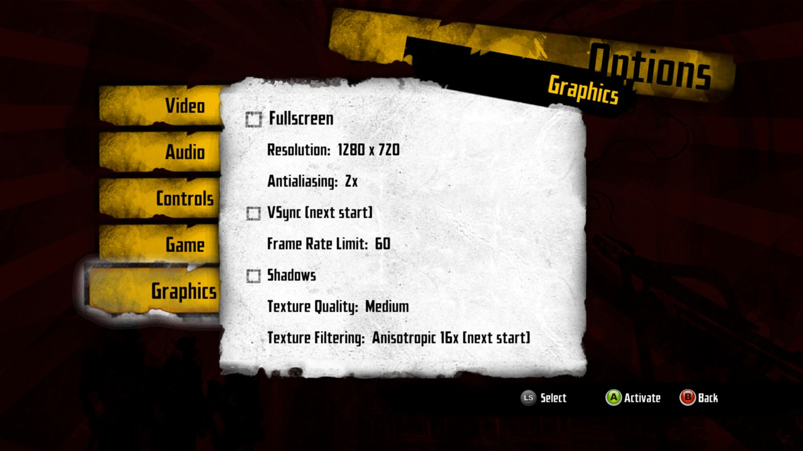
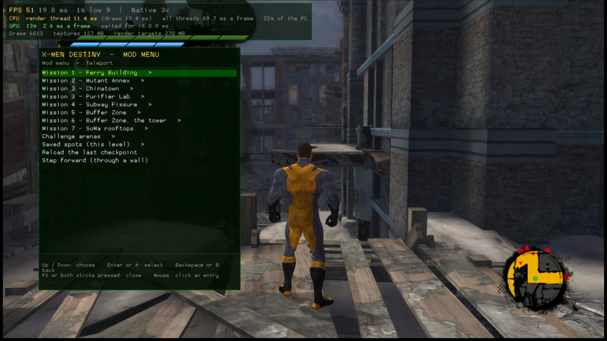
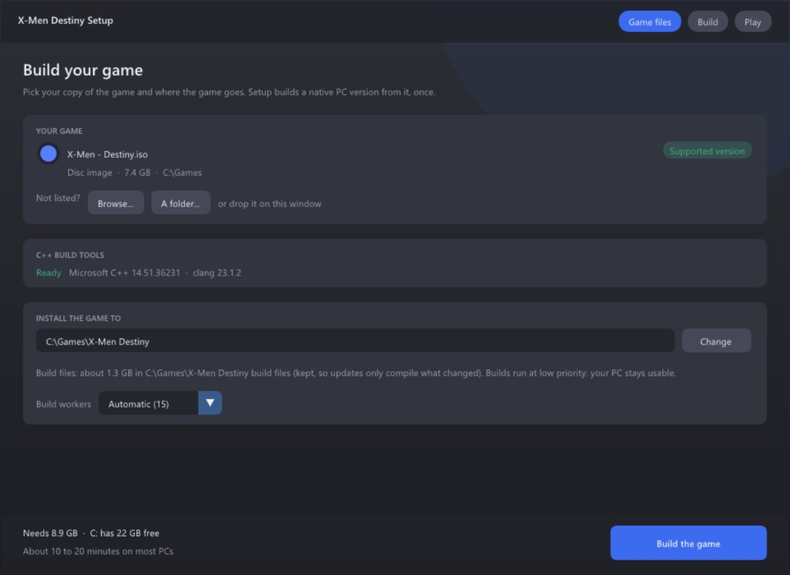
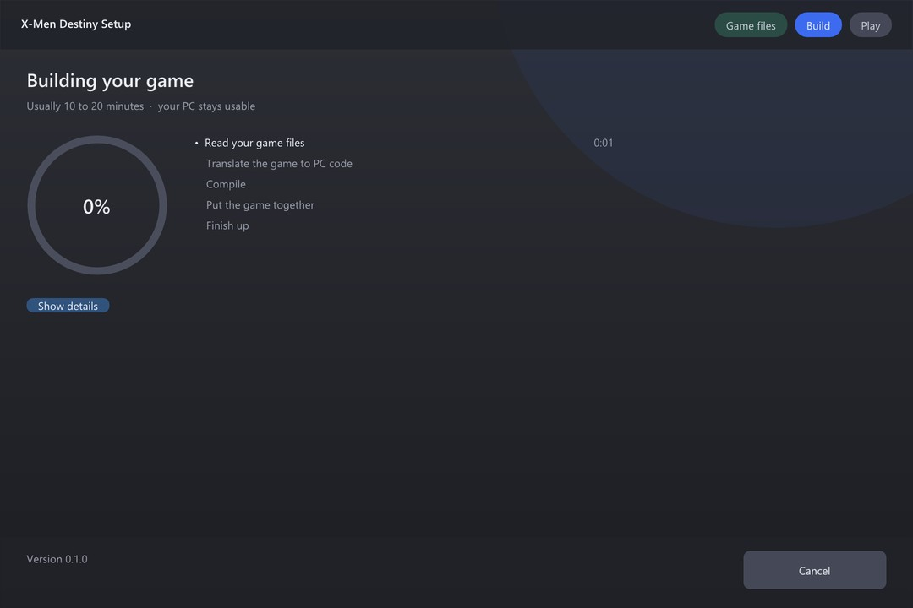
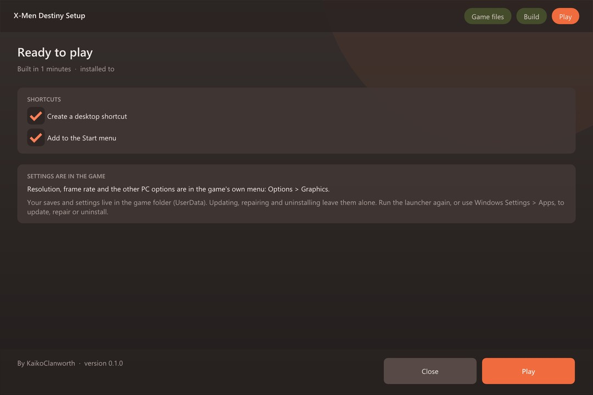
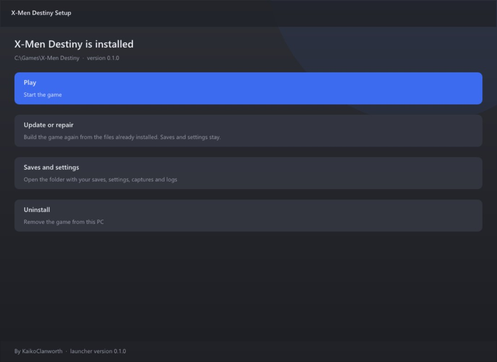

<h1 align="center">X-Men: Destiny — PC Port</h1>

  The 2011 Xbox 360 game, running natively on Windows. Not an emulator. 
  <b>By KaikoClanworth</b>

  

> [!IMPORTANT]
> **There is no game in this repository.** You need your **own copy** of *X-Men: Destiny* for Xbox 360. The setup builds the PC version from it, on your PC.

> [!WARNING]
> **Work in progress.** The game is playable, but the port isn't finished and the first download isn't out yet.

---

## Pictures

<table>
  <tr>
    <td width="50%"> <b>In a level</b></td>
    <td width="50%"> <b>A fight</b></td>
  </tr>
  <tr>
    <td> <b>A cut-scene</b></td>
    <td> <b>Options → Graphics</b>, new in the game's own menu</td>
  </tr>
  <tr>
    <td> <b>Mod menu</b> (F1): cheats, warps, cut-scenes</td>
    <td></td>
  </tr>
</table>

All pictures are of this port running.

---

## What works today

- ✅ **The game starts and plays**: movies, menus, cut-scenes and missions. Not every mission has been played through yet.
- ✅ **Sharper picture**: higher resolutions than the console's 720p, anti-aliasing and better texture filtering.
- ✅ **Controllers**: Xbox, PlayStation, Switch Pro and others.
- ✅ **PC options in the game's own menu**: *Options → Graphics*, and *Exit* on the main menu.
- ✅ **Mod menu**: cheats, warps to the game's checkpoints, cut-scenes, game speed.

**Not there yet:** keyboard and mouse play, controller remapping, button prompts for other controllers, and a steady frame rate above the console's 30 fps. Some picture faults remain (shadows, flicker on a few effects). The full list is in [docs/STATUS.md](docs/STATUS.md).

---

## How to install

> The setup is still being tested. The first download isn't out yet.

**You need**

- Your own *X-Men: Destiny* **Xbox 360** game, as a disc image (`.iso`) or as a folder of its files. The setup checks it and tells you if it's a version it doesn't know.
- Windows 10 or 11 (64-bit), a graphics card with Direct3D 12, and about **9 GB** of free space.
- A controller.

**Steps**

1. **Download** the latest `XMenDestiny-…-Windows-x64.zip` from [Releases](../../releases/latest) and unzip it anywhere.
2. **Open `XMDSetup.exe`** and pick your copy of the game and where to install it.
3. Press **Build the game**. The setup turns your copy into the PC version. This takes about 10 to 20 minutes, once.
4. Press **Play**.

<table>
  <tr>
    <td width="50%"> <b>1.</b> Pick your game</td>
    <td width="50%"> <b>2.</b> The setup builds it</td>
  </tr>
  <tr>
    <td> <b>3.</b> Ready to play</td>
    <td> <b>Afterwards</b>: play, update or repair, uninstall</td>
  </tr>
</table>

**Build tools.** The game is built on your PC, so the setup needs Microsoft's free *Build Tools for Visual Studio 2026*, with **Desktop development with C++** and **C++ Clang Compiler for Windows**. If they're missing, the setup offers to install them for you.

Your saves and settings are kept in the `UserData` folder inside the game folder. Updating, repairing and uninstalling leave them alone.

---

## Keys

The game plays with a controller, laid out as on the Xbox 360. The port adds these keys:

| Key | What it does |
|---|---|
| **F1**, or both sticks pressed in | Mod menu |
| **F2** | Frame rate display |
| **F4** | Capture, for a problem report |
| **F5** | Freeze the world |
| **F6** | Settings window |
| **F11** | Fullscreen on / off |

Picture settings are in the game: **Options → Graphics**.

---

## Something wrong?

1. Press **F4** while the problem is on screen.
2. Open an [issue](../../issues/new/choose) and attach the files the form asks for, from the new folder in `UserData\captures`.

Please don't attach the `state` folder from a capture: it holds the game's own data.

---

## More

- [State of the port](docs/STATUS.md): what works, what doesn't, what's next.
- [Building from source](docs/BUILDING.md): for developers.

## Credits

- **KaikoClanworth**: project lead, direction and testing.
- **[Claude Code](https://claude.com/claude-code)** (Anthropic's AI coding assistant) wrote most of the port's code, tools and docs.
- **[ReXGlue](https://github.com/rexglue/rexglue-sdk)**: the recompiler and runtime the port is built on, derived from **[Xenia](https://github.com/xenia-project/xenia)**.
- **[plume](https://github.com/renderbag/plume)** and **[XenosRecomp](https://github.com/hedge-dev/XenosRecomp)**: the graphics layer and the shader converter.

## Legal

This is an unofficial fan project, not affiliated with or endorsed by Marvel, Activision, Silicon Knights or Microsoft. *X-Men: Destiny* and all related names and characters belong to their owners. No game material is included; the pictures above show the port running and what they show belongs to the game's owners. The port's own code is under the [MIT licence](LICENSE).
